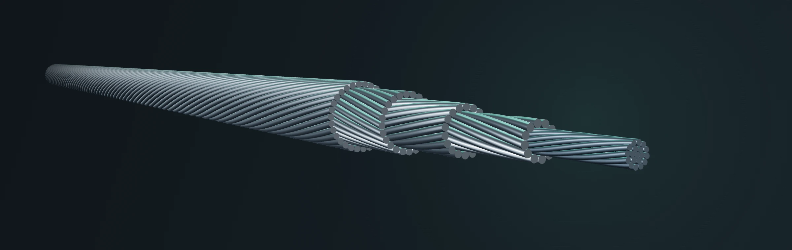

<p align="center">
  
</p>

# OpenLine

[](https://github.com/BirchfieldResearchGroup/openline/actions/workflows/ci.yml)
[](https://pypi.org/project/openline/)
[](https://pypi.org/project/openline/)
[](https://openline.readthedocs.io)
[](LICENSE)

OpenLine is a Python library for modeling overhead transmission lines. It calculates line
impedance and admittance, conductor ampacity, sag, and tension, with a catalog of conductors
and structures drawn from standards and manufacturer documents.

[Documentation](https://openline.readthedocs.io): examples, conductors, structures, and API.

```bash
pip install openline
```

```python
from openline import conductors, electrical, mechanical, units as u

drake = conductors.astm.b232.DRAKE
resistance = electrical.resistance(drake, temperature=u.celsius(75), frequency=u.hz(60))
print(resistance)  # 0.08559 Ω/km
print(mechanical.mass(drake))  # 1.63 kg/m
```

| Module | Purpose |
| --- | --- |
| `conductors` | Conductor designs by standard, with `of` and `named` to search them |
| `structures` | Tower, frame, and pole designs, with `of` and `named` to search them |
| `electrical` | Conductor resistance and named line impedance/admittance, including sequence conversion |
| `ratings` | Ampacity, temperature, and temperature profiles using IEEE Std 738-2023 |
| `mechanical` | Mass, strength, elasticity, expansion, sag, and tension |
| `units` | Typed quantities and scalar, complex, or matrix unit conversion |
| `types` | Detailed construction, material, geometry, and result types |

Common inputs such as `Line`, `Circuit`, `Strung`, `Environment`, and `Surface` are exported
from `openline`. Advanced component models remain in `electrical.series` and `electrical.shunt`.

Calculations take a conductor's construction, its materials and its standard alone; the catalog
holds no reported values. The
[validation results](https://openline.readthedocs.io/en/latest/development/validation.html)
compare each calculation with what manufacturers and standards report.

## Author

[Luke Lowery](https://lukelowry.github.io/), PhD student in the
[Birchfield Research Group](https://birchfield.engr.tamu.edu/) at Texas A&M University ·
[Google Scholar](https://scholar.google.com/citations?user=CTynuRMAAAAJ&hl=en) ·
[ORCID](https://orcid.org/0009-0000-0029-3403)

Also by the author: [pyvectorfit](https://github.com/BirchfieldResearchGroup/pyvectorfit), vector
fitting for EMT line models.
